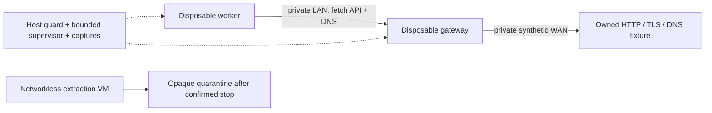

# S14 closed gateway and target admission

24 October 2026, single Ubuntu Linux host. This follows the
[trusted guest fixtures](s14-benign-guest-validation.md) and preserves the
[I01–I08 acceptance criteria](s14-two-pc-linux.md#isolation-gate-before-real-targets).
**Real egress and detonation remain unavailable.** Results below concern an
owned synthetic WAN; they do not accept a live uplink, production collector,
browser, suspicious URL, attachment or any attribution claim. R08 remains open.

## Effective topology

Two disposable KVM guests have distinct roles. Worker `192.0.2.20` has one NIC
on the unnumbered `pawbr-int`. Gateway `192.0.2.1` has a second NIC
`198.18.40.2` on the unnumbered `pawbr-wan`. A trusted namespace owns synthetic
WAN listener `198.18.40.10` and denied canary `198.18.40.11`; it has neither a
default route nor forwarding. Neither bridge contains a physical interface.
No NAT, host DNS/DHCP, libvirt network autostart or Internet route is added.

The host's independent `bridge paw_s14_roles` policy pins ingress TAP, MAC,
IPv4/ARP sender, destination, transport and port, with explicit forwarding port
pairs to prevent flooding to an unexpected bridge member. IPv6, tagged Ethernet,
MPLS, IPv4 fragments and unadmitted protocols are dropped. Independent `inet`
tables deny bridge input/output/transit at the host. Gateway forwarding is off
and its own nft input/output/forward chains default to drop. Rules affect only
the dedicated PAW tables; no global host rule flush or forwarding change occurs.

The actual Wi-Fi IPv4 address is used only for an owned host canary. A scoped
host rule blocks non-loopback access to that listener. No LAN neighbor is probed.

## Target admission boundary

This fixture uses a bounded fetch API on TCP 3128, not a general CONNECT proxy.
Only fixed `.fixture.invalid` names, HTTP 18080 and HTTPS 8443 are admitted.
Each connection and redirect gets a fresh DNS lookup against the owned resolver
on UDP 5353. Every returned address must be exactly `198.18.40.10`; a mixed set,
private/link-local/mapped/literal alternative, unknown name, userinfo, ambiguous
authority or disallowed port rejects. Sockets connect directly to the admitted
numeric address and check the peer; TLS verifies the fixed test CA and hostname.
The CA establishes only this owned fixture relationship.

`offline-fixture` is the only executable transport mode. The inert public-IPv4
classifier is a tested policy vector, not an implemented live transport.
Switching to a real resolver, destination set, uplink or browser invalidates this
profile's acceptance. No existing PAW active-provider entry point is enabled.

Per job: 32 fetch/redirect attempts, three redirects, 8 KiB response body,
32 KiB aggregate body, a fixed job token and monotonic expiry up to 120 seconds.
The gateway services have 32 tasks / 128 MiB; each guest has one vCPU / 512 MiB,
with host scope limits of 64 tasks / 768 MiB, no swap and 50% CPU. The aggregate
slice now has 128 tasks / 2 GiB, no swap and 100% CPU. The initial twelve-case
matrix used the stricter 1,280 MiB aggregate cap. This validates a
headless fixture; browser capacity is not established.

## Supervision, storage and reproduction

The independent libvirt owner creates transient paused AUTODESTROY domains,
checks effective filter fingerprints and capture identities, applies cgroup
limits, verifies non-root QEMU and enforcing AppArmor, and then resumes guests.
The outer controller sends a bounded management heartbeat. Guest health reports
the broker/resolver processes, firewall fingerprint and UTC/monotonic relation.
Host/guest filter change, process/capture loss, missed heartbeat, clock step,
unexpected bridge membership or expiry closes the owning connection. Stable
artifacts require domain, identified QEMU and TAP absence, followed by capture
stop. Unknown stop blocks publication.

Use a bounded PID1 systemd service, not a desktop `--scope`: the desktop AppArmor
profile cannot signal the confined tcpdump process. AppArmor stays enforcing.
The base is the previously signature/hash-verified Ubuntu image. The guest nft
binary and all loader dependencies are copied from verified installed Ubuntu
packages with a source hash/alias inventory; guests install nothing and have no
host shares, originals, credentials, Docker socket or host filesystem mounts.

The extractor boots without a NIC, then receives the stopped worker disk read
only. Attaching it after boot avoids duplicated cloud-image filesystem UUIDs
selecting the evidence disk for `/boot`. The filesystem is mounted `ro,noload`
inside that VM. Output admission bounds count, names, types, bytes and hashes;
the host receives bounded opaque records, verifies them again and stores ordinal
`.bin` files. HTML is not rendered and archives are not expanded.

Operator-only fixed fixtures are in `lab/s14/`. CI compiles them and exercises
inert admission/quarantine tests; CI does not validate KVM or the local topology.
The privileged matrix requires the verified base, the separately recorded nft
runtime bundle, no existing domains and empty private bridges. It deliberately
refuses an occupied or changed lab. It is not a general detonation launcher.

## Historical component checkpoint and final acceptance

The table below records the composed checkpoint before the final complete repeat
on the 2 GiB profile. The latest full-profile result and exact-head CI are
recorded in [PR100](https://github.com/NOEMETRA/PAW--Phishing-Attribution-Workbench--/pull/100)
and the retained stopped-run evidence; no result is inferred from a scheduled run.

That historical evidence combines the main component matrix and targeted correction checks.
**The original main run remains FAIL**: all twelve component scenarios passed,
but final cleanup used a stale network handle after restarting libvirt. The
empty WAN was recovered with no domains/ports; the handle is now reacquired on
the new connection. A separate real reproduction showed worker-domain loss
leaving its gateway alive; the owner now checks each identified QEMU process.
The corrected three-case run also repeats guard startup failure and complete
post-restart cleanup. That composed checkpoint did not claim a full rerun of all twelve scenarios
on the final supervisor source or enlarged budget. A later full run supersedes
that limitation only when its own stopped evidence verifies.

| Check | Measured result |
| --- | --- |
| Main components | PASS, 12 scenarios: traffic, networkless extraction and ten lifecycle faults. Enclosing run FAIL for the stale-handle cleanup above. |
| Target admission | PASS: HTTP/TLS and allowed redirect; private redirect/rebinding, loopback, metadata, mixed DNS, incorrect DNS transaction ID, TLS hostname mismatch, alternate IP forms, wrong token, CONNECT, disallowed names/ports and request/body/redirect limits. |
| Host/L2 denial | PASS: owned host and forbidden WAN positive controls unchanged; direct TCP/DNS/UDP and twelve constructed MAC/IP/ARP/IPv6/tag/fragment/tunnel classes blocked, with external drop counters and no matching WAN requests. These are finite vectors, not complete protocol grammar coverage. |
| Missing guards/capture | PASS: seven actual admissions rejected before guest creation, three tables empty/absent and missing capture identity. |
| Active faults | PASS: broker, DNS, host inet, host bridge, guest filter, guest clock, capture, owner, management heartbeat and expiry. Stop latency 0.976–4.052 s, below the 12 s oracle. |
| Storage/extraction | PASS: bounded guest tmpfs ENOSPC, seven output objects, three admitted opaque files / four rejected names/types/sizes, no extractor NIC, source QCOW2 hash unchanged. Host-disk exhaustion is not tested. |
| Corrected supervision | PASS: worker loss 0.902 s, gateway loss 0.939 s, unexpected bridge port 1.133 s; all writers stopped automatically. Guard-failed startup and successful final cleanup pass again. |
| Budgets | Initial aggregate reaches 1,280 MiB with cache reclamation and no observed OOM. After the user's increase to 2 GiB, the targeted run peaks at 1,460.0 MiB and 74 tasks (sampled), with swap disabled. Guests remain 512 MiB. A prior 64 MiB injection did not terminate QEMU and is retained as FAILED INJECTION, not a passed OOM test. |
| Reconciliation | PASS: 1,201 main PCAP packets, request/target logs, source hashes, stop reasons, quarantine hashes and exact two-file runtime delta. Normal verification rejects the original FAIL; explicit component mode never promotes it to a matrix PASS. |
| CI | Inert URL/DNS/quarantine tests and syntax checks are automated. CI does not validate local KVM/network/fault acceptance. Exact-head results are recorded in the PR. |

Only the supervisor's process-loss check and network-handle reacquisition, plus
the aggregate slice budget, differ from the main component freeze. The read-only
verifier checks that exact delta. Failed bootstrap/serial/cleanup/injection
attempts and the worker-loss reproduction remain separate evidence. The package
under `paw/`, scoring, originals, prior evidence and seals are unchanged.

## Final full profile and cold-boot acceptance

The final full matrix at runtime source `5736a53` (identical runtime bytes on
head `712c4e8`) passes all twelve scenarios on the 2 GiB aggregate profile.
All 27 runtime/policy sources remain frozen. Independent reconciliation checks
1,201 packets and the complete output inventory; ten fault stops take
0.977–3.970 seconds. Final guard-failed libvirt startup and cleanup pass. CI on
`712c4e8` passes all seven jobs. The historical component-only limitation above
is superseded by that complete stopped-run record; earlier FAIL evidence stays
unchanged.

The actual host reboot was measured on 24 October 2026:

- Boot ID changes from `2d078918-b7b2-416f-abf5-aa36033d656b` to
  `7dd92ea7-3191-492d-bd6d-5e224279dbde`.
- The enabled host guard is active 18.942357 seconds after boot. Effective
  fingerprints, installed rule/unit hashes and the root-owned read-only base
  image match the passing matrix.
- Libvirt and its UNIX control sockets intentionally remain stopped at cold
  boot. The first read-only query therefore refuses with a missing UNIX socket;
  that diagnostic attempt is retained. No guard, VM or network is started to
  turn the cold-boot guard check into a pass.
- After confirming the guard is already active and no domain/network autostart
  entries exist, the operator starts only the local UNIX sockets and libvirtd.
  The daemon becomes active at 558.580296 seconds, after the guard. Persistent
  service/network autostart settings are unchanged; no guest start is requested.
- `verify_gateway_reboot.py` then returns PASS: no domains/QEMU, no private
  bridges or fixture namespace, both defined networks inactive with autostart
  off, and no libvirt TCP/TLS listener. The 2 GiB / 128-task / zero-swap budget
  persists.
- Kernel, QEMU, nft, the installed nft loader/runtime and all 27 source hashes
  match the full matrix. SMT remains off, KVM entry L1D flush remains always,
  and the L1TF/GDS boot mitigations remain configured. Management addressing and
  the physical uplink inventory are unchanged.

This closes the missing cold-boot measurement for the **fixed closed profile**.
The configuration consistency review covers its pinned roles, synthetic target
allowlist, independent host guards, stopped-writer publication and frozen
versions/hashes. It is not an independent certification or general hostile-code
acceptance.

**The overall S14 real-egress/collector gate remains OPEN.** The current mode is
still `offline-fixture`, with no physical WAN port or live transport. An actual
uplink, admitted real-target scope, broader collector/browser/detonation
contracts and their review/authorization remain separate acceptance work.
R08 remains open. Neither a cold-boot PASS nor a matching hash authorizes real
egress or detonation.

For subsequent cold-boot checks, first record that the enabled guard is already
active and matches the previous freeze. If it is absent/changed, stop: manually
starting it would not establish successful boot ordering. If only the local
libvirt control plane is stopped, check that autostart entries are empty before
explicitly starting `libvirtd.socket`, `libvirtd-ro.socket`,
`libvirtd-admin.socket` and `libvirtd.service`. Then run
`lab/s14/verify_gateway_reboot.py` against the latest passing full-profile
`results.json`. The checker stays read-only, rejects the same boot ID and does
not start guests or lab traffic.

The next [Wi-Fi routed-uplink preparation](s14-uplink-profile.md) is a separate,
disabled candidate and evidence set. Its owned-namespace/KVM routing tests do
not change the closed-profile measurements above or enable live transport.
