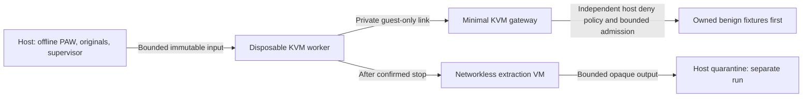

# S14: closed preparation on one Linux PC

Current follow-up: [closed gateway and target admission](s14-gateway-validation.md),
including corrected supervision, a 2 GiB aggregate budget and the still-open gate.
The measurements below retain their historical profile.

Initial preparation record at `42fc8d6`. The later
[trusted-guest traffic/failure matrix](s14-benign-guest-validation.md) adds a
verified image, tighter budgets and actual benign guest execution. Read that
follow-up for current measured results and remaining gates; the paused-only
statements below describe this initial stage.

24 October 2026. The user requires all laboratory work on the current Linux
computer. This supersedes the hardware allocation in the earlier
[two-PC proposal](s14-two-pc-linux.md), while preserving its isolation gates and
evidence contracts. **Controlled egress is unavailable; I02–I08 have not passed.**
No real detonation, suspicious lookup/URL, attachment execution or guest OS
execution occurred in this preparation.

This is a separate preparation branch from PR99 head
`1df7d4b42e14df2ca6e867aec28d41d4cd895b54`. R08, scoring, originals, existing
cases/seals and consolidated audits retain their previous dispositions.

## Measured platform prerequisite

The actual computer is a Lenovo ThinkPad X260 / Intel i7-6500U, with 7.1 GiB
RAM, approximately 166 GiB free disk, Ubuntu 26.04.1 and kernel
7.0.0-38-generic. BIOS VT-x was initially disabled. After the owner's firmware
change, `/dev/kvm` was available to the current user through its existing ACL;
no membership in a privileged management group was added.

The kernel initially reported GDS without a mitigating microcode update, plus
L1TF/MDS/MMIO with SMT vulnerable. A root-owned GRUB drop-in was applied using
ordinary desktop administrator authentication, with `l1tf=full` and
`gather_data_sampling=force`. Generated GRUB syntax and the normal kernel entry
were checked, the computer rebooted, and the new boot was measured:

| Check | Actual observation |
| --- | --- |
| Effective command line | Both requested options present. |
| SMT / KVM L1D flush | `off` / `always`; two logical CPUs online. |
| L1TF | PTE inversion, VMX cache flushes, SMT disabled. |
| GDS | `Mitigation: AVX disabled, no microcode`. |
| MDS / MMIO stale data | CPU buffer clearing, SMT disabled. |
| KVM supported CPUID | API 12; AVX and AVX2 bits false; XSAVE YMM state absent. This query did not execute a guest vCPU. |
| QEMU | 10.2.1, initially distribution build `1:10.2.1+ds-1ubuntu3.2`. |
| Libvirt | `12.0.0-1ubuntu5.6`, installed from Ubuntu repositories with declared dependencies. |
| AppArmor | Active; the actual libvirt probe had a per-domain profile in enforce mode. |

Disabling SMT/AVX has performance and application-compatibility costs. The
kernel build's `CONFIG_MITIGATION_GDS` default was unset; upstream Linux 7.0
retains the explicit `force` parser. The measured post-boot state, rather than
that configuration label alone, is the evidence of the selected mitigation.
This does not establish that every possible hardware vulnerability is absent.
[Linux L1TF](https://www.kernel.org/doc/html/latest/admin-guide/hw-vuln/l1tf.html),
[Linux GDS](https://www.kernel.org/doc/html/latest/admin-guide/hw-vuln/gather_data_sampling.html),
[Linux 7.0 selection/parser](https://github.com/torvalds/linux/blob/v7.0/arch/x86/kernel/cpu/bugs.c#L799).

Docker Desktop and its pre-existing LinuxKit VM were stopped gracefully; it
remained stopped after reboot. Available RAM rose from approximately 2.8 to
3.7 GiB when it was closed; later measurements varied around 3.3–3.8 GiB.
Codex and desktop services remained running. The pre-existing system Docker
daemon, socket and `docker0` were inventoried and retained. No Docker command
or workload was started by this work. These background services and their
rules must remain part of the later effective-configuration/startup tests.

## Configuration actually prepared

The [lab configuration directory](../lab/s14/) contains the files exercised on
this host. They form a **closed preparation network**, not an egress launcher:

- [internal-network.xml](../lab/s14/internal-network.xml): `paw-s14-internal`,
  bridge `pawbr-int`, no `<forward>`, host IP, DHCP or DNS service. Autostart is
  disabled. After the probe stopped, the bridge had no addresses or attached
  ports; IPv6 was disabled on the bridge.
- [host-guard.nft](../lab/s14/host-guard.nft): one PAW-owned inet table, with
  input/output/forward drops scoped to `pawbr-int`, for both IP families. It
  permits no routed worker egress. Loading it uses one transaction and clears
  only that table. It does not flush the host ruleset.
- [paw-s14-guard.service](../lab/s14/paw-s14-guard.service) and
  [libvirtd-guard.conf](../lab/s14/libvirtd-guard.conf): apply the guard before
  the local monolithic libvirt daemon. No ExecStop removes the rules. The
  guard is enabled at boot; its actual post-reboot behavior is still untested.
- [paused-probe.xml](../lab/s14/paused-probe.xml): empty q35/KVM platform probe,
  with no disk, shared filesystem, graphics, clipboard, USB passthrough or
  guest agent. It was created transiently with **`virsh create --paused`**,
  queried without `cont`/resume, and destroyed. Do not use this XML as a
  worker launcher or omit the paused launch requirement.

During package installation, temporary service-start policy and runtime masks
prevented virtualization/network daemon startup. The temporary policy was
removed after successful installation. Default NAT autostart was removed
before deliberately starting local UNIX sockets. The default network remained
inactive. Local daemon startup was then allowed only after the PAW guard was
active. TCP/TLS libvirt sockets are runtime masked; guests and the internal
network are not configured to autostart.

Libvirt added its own chains and jumps in the existing ip/ip6 filter/NAT tables,
and mangle tables. All 44 pre-existing nftables objects were retained without
rewrites, excluding counter values/handles in the comparison. **Table-level
equality is not claimed.** The separate PAW table has priority -310 and four
drop rules. These observations do not replace packet-level verification or
tests after another service rewrites filtering.

Libvirt documents that an isolated network with a host IP still allows host
communication, and provides a no-gateway-address configuration. Absence of a
host address alone is also insufficient as a host-access policy; the independent
filter and actual denied-traffic tests are required.
[Libvirt network format](https://libvirt.org/formatnetwork.html).

## Actual validation and limits

| Test | Result and scope |
| --- | --- |
| Direct unprivileged KVM creation, before/after CPU mitigation reboot | PASS. Paused empty machine, no disk/NIC, KVM enabled, clean QMP exit and stopped process. No guest instruction execution. |
| Network/domain schemas and systemd unit syntax | PASS against installed libvirt schemas and systemd. nft syntax checked by the kernel before applying. |
| Libvirt empty transient probe | PASS. UID 64055, per-domain AppArmor enforce label, seccomp enabled, KVM active, no block devices, QMP `prelaunch` / `running: false`. |
| Actual cgroups for that probe | PASS for the specified limits: `memory.max=402653184`, `memory.swap.max=402653184`, `cpu.max=50000 100000`. Swap is a separate 384 MiB allowance, not a claim of a 384 MiB combined total. The scope PID limit was 16384 and is not accepted for future untrusted workers. |
| Probe teardown | PASS. Its libvirt domain disappeared, observed QEMU PID stopped, temporary control directory removed only after stop, bridge ports empty. |
| Installed PAW replay after AVX disable | PASS on CPython 3.14.4: all 103 installed wheel files, console, five offline presets, complete ZIP/original bytes, seals, numeric/profile parity, deadline stop, and owned-loopback API/assets/export. Cleanup confirmed stopped trees before removing successful fixtures. No full-suite rerun or classifier-accuracy claim is added here. |
| Executing guest / traffic / containment failure tests | NOT RUN. These configuration and paused probes do not pass I02–I08. |

Two host-preparation attempts stopped before completing network setup: the new
configuration directory inherited group-write permission from umask 002 and
was refused; the minimal install omitted optional `virtlockd.socket`, so an
unconditional socket-start request failed. The host-specific helper tightened
only its identified empty directory and started installed sockets only. The
successful replay is recorded separately from both failures. The empty probe
has no writable storage; the optional storage lock daemon and locking policy
remain to be selected before writable guest-image admission.

Private evidence retains the raw commands, effective rules/configuration,
before/after measurements, failed attempts, process identity and installed
replay logs. The repository contains no original mailbox copy, credentials or
host-specific raw management inventory.

## Next bounded stages

Use the single host as the trusted PAW/originals and management plane. The
intended later topology is:

The gateway, uplink, target-admission proxy/resolver, job supervisor and
networkless extraction path are **not implemented by these files**. The current
guard deliberately blocks routed traffic on the private bridge; enabling a
gateway later is a material policy change requiring another measured gate.
There is no physical separation from the development machine. QEMU must retain
its own unprivileged identity, MAC confinement and verified resource limits;
no host filesystem, agent, credential or originals are shared with guests.
[QEMU security requirements](https://www.qemu.org/docs/master/system/security.html).

Before executing even the first trusted guest fixture, select a vendor image
with verified provenance/hash, storage locking and fresh overlay handling,
CPU/RAM/swap/PID budgets, and bounded serial/control/output channels. Start with
small collectors and one job at a time; browser capacity is not established on
this 7.1 GiB, two-online-CPU machine. Returned filesystems must be parsed in a
networkless disposable extraction guest, not mounted on the host.

I02–I08 from the earlier proposal remain required, with local host/gateway/
worker roles replacing the two physical PCs. Use owned host canaries and a
separate synthetic LAN segment; do not scan ordinary LAN devices. Require
IPv4/IPv6 and spoofing denial, the only admitted resolver/proxy path,
redirect/rebinding checks, removal of established flows on faults/expiry,
capture/supervisor failure handling, startup/reboot ordering, storage/reset and
quarantine admission, and independently reconciled evidence. Freeze the actual
versions/images/policy after review. Real-target authorization is separate;
this preparation authorizes no detonation and closes neither S14 nor R08.
