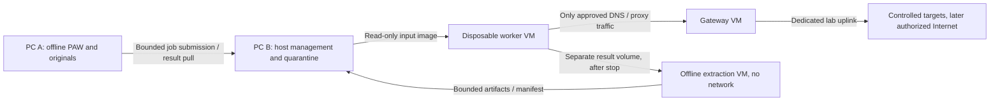

# S14 proposal: two Linux PCs and isolated egress

Proposal following the [Linux/R08 measurements](linux-r08-validation.md),
23 October 2026. **Not implemented or isolation-validated.** No second-PC
hardware inventory, remote access, network layout or successful containment test
is available in this session. Those observations are prerequisites to choosing
interface names, addresses, hypervisor settings or deployment commands.

## Roles and network boundaries

Keep the current development PC (A) for source, offline PAW, sealed originals,
review and exports. Dedicate PC B to the lab: a minimal Linux/KVM/libvirt host,
an independently controlled gateway VM and disposable collector/browser VMs.
Initially admit browser collection only; arbitrary attachment execution remains
a separate capability, even after the network gate passes.

This is a proposed trust separation, not an assertion that a diagram enforces it.
The worker network must have no route to PC A, the normal LAN, host management,
hypervisor services or original-case storage. Use a dedicated physical management
link and a separate lab uplink; PC A does not forward packets. Do not put PC B's
lab WAN on an ordinary home/office LAN without an independently enforced upstream
deny policy. An isolated router/VLAN must deny that LAN and management, even if
the gateway VM is misconfigured. Keep management and lab keys out of guests.

For PC B, provision two physical NICs where feasible: one management-only link
and one dedicated uplink for the gateway. A worker has one virtual NIC on a
private guest bridge, with no physical NIC or host IP on that bridge. Only the
gateway has a second NIC. Decide between an unnumbered dedicated WAN bridge and
device passthrough after inventory/IOMMU review; passthrough is not a prerequisite
to declare without testing. Disable unused Wi-Fi/Bluetooth, extra guest NICs,
default NAT networks and accidental host forwarding. Host updates occur in a
separate maintenance mode with workers stopped.

Libvirt explicitly distinguishes NAT/bridged connectivity from isolation; an
isolated network with a host address still permits guest/host communication.
Its documented no-gateway configuration avoids assigning host IPs to that guest
network. Neither setting replaces host filtering or the gateway policy.
[Libvirt network format](https://libvirt.org/formatnetwork.html)

## Enforcement and evidence

Use an explicit default-drop filter policy at PC B's host and gateway, including
input/output/forward paths and IPv4/IPv6. Account separately for bridged traffic,
ARP/NDP and libvirt/firewalld rule ordering; NAT is not a filter. The gateway
permits only the current job's resolver/proxy flows to pre-approved destinations,
with time, byte, connection and request budgets. No direct external guest DNS,
UDP/QUIC, generic CONNECT tunnel, alternate proxy or arbitrary outbound socket is
allowed. Initially deny IPv6 and tunneling consistently unless an equally tested
IPv6 path is deliberately enabled. These are design requirements awaiting a
measured ruleset, not a ready-to-apply firewall recipe.
[nftables hooks, policies and chain ordering](https://wiki.nftables.org/wiki-nftables/index.php/Configuring_chains)

DNS/proxy admission must reject management, host, local/private/link-local,
metadata, multicast and otherwise nonpublic destinations; bind each permitted
connection to its admitted address. Check every redirect and new resolution,
including rebinding, IPv4-mapped IPv6 and literal IP forms. An allowed hostname
alone is insufficient. Record resolver responses, connection destinations,
redirect chains, timestamps, TLS verification status, errors and denied attempts.
Preserve raw artifacts separately from interpretations; a capture does not prove
the identity behind a domain or the authenticity of supplied content.

Keep gateway/host capture and firewall counters outside the disposable worker.
If the capture, supervisor, policy check or clock provenance fails, refuse a new
job and mark an active result incomplete; cut the job's permitted flows and stop
the VM. Job expiry and an operator kill action remove permission independently
of Python or browser cooperation, including already established connections.
Verify PC A/management and upstream observations rather than trusting guest logs.

Run QEMU with a dedicated unprivileged identity and the distribution's mandatory
access controls. Do not expose host filesystems, shared clipboard, USB devices,
SSH agents, browser profiles, Docker/libvirt sockets or credentials to workers.
Use a known hashed base image plus a fresh writable overlay per job; preserve
needed disk artifacts before discarding the overlay, and prove reset with a
marker test. QEMU supports backing images and snapshots; the selected reset
procedure must still be validated against the actual storage configuration.
[QEMU disk images](https://www.qemu.org/docs/master/system/images.html)

## Job and result contract

PC A submits an immutable bounded job: job ID, parent case ID/seal reference,
minimal selected input hashes, PAW version, requested collector, allowed targets,
budgets and expiry. Send the minimum required URLs/bytes; no whole-mailbox copy
or signing/provider secret. A fixed management command/service validates this
schema. It must not interpolate sample strings into shell commands or let jobs
choose host paths, mounts, image filenames or firewall rules.

No existing sealed case is updated in place. PC B produces a separate run with
input/policy/image/software hashes, requested and actually attempted operations,
raw captures and their hashes, omissions, errors and termination evidence. API
tokens, if later needed for benign provider queries, belong to a separate bounded
collector identity and remain inaccessible to the browser VM.

Stop the worker and confirm no writers remain before collecting its result
volume. Parse guest filesystems in a disposable **networkless extraction VM**;
do not mount a guest-controlled filesystem on PC A or the management host.
Export opaque bytes with strict path/type/size/count admission to a quarantine
directory. PC A pulls through a narrow authenticated read-only channel; PC B
does not initiate connections to PC A. Returned HTML/JS/downloads remain inert.
Reject path traversal, symlinks, special files, archive expansion and unexpected
types; unavailable/partial collection must never become a successful visit.

The clean supervisor hashes/seals the admitted inventory and records its own
provenance. Guest-provided hashes, a matching PAW seal, a transport signature or
an external log field do not authenticate remote content or operator identity.
The existing unavailable Rekor/PGP contracts remain in effect until their own
independent acceptance; no new signature claim is implied by this proposal.

## Isolation gate before real targets

All first-stage tests use constructed inputs and owned benign listeners. No
suspicious domain lookup, URL visit, browser detonation or attachment execution
precedes a recorded PASS of this gate on the actual second PC.

| Gate | Required measured evidence |
| --- | --- |
| I01: host/network inventory | CPU virtualization, RAM/disk, NICs, firmware/kernel/QEMU/libvirt versions, routes, bridge/VLAN membership, resolver configuration, loaded rules and startup dependencies. Record inaccessible/unknown facts. |
| I02: management/LAN denial | From a disposable guest, attempt owned listeners on PC A, PC B management/host and a benign LAN segment. Capture denied paths externally, including IPv6/link-local and spoofed source/MAC attempts. No reachable management service. |
| I03: outbound policy | Only an owned permitted resolver/proxy/target succeeds; direct IP/DNS, other ports, UDP/QUIC, IPv6/tunnel paths and alternate resolvers fail. Capture both sides; test disabled/absent rules and reboot/startup ordering. |
| I04: redirect/rebinding | Controlled DNS and HTTP fixtures redirect/rebind to owned forbidden listeners. Check every connection; no request reaches the forbidden listener. Verify alternate IP encodings and mapped addresses. |
| I05: fail-closed lifecycle | Kill proxy/resolver/capture/supervisor, lose the management link, expire budgets and reboot PC B. Egress closes, established flows cease, all writers stop, and partial artifacts are labelled/sealed only after stop. Unknown stop state blocks stable publication. |
| I06: storage/reset | Worker cannot access originals, secrets, host sockets, shared folders or other jobs. Quarantine rejects malformed/traversal/oversized outputs. A fresh overlay has no prior marker; prior admitted artifacts remain unchanged. |
| I07: chain of evidence | Independently reconcile submitted hashes, actual targets, packet/request logs, clock offsets, omissions, output inventory and parent linkage. Test failed/partial runs, not only successful collection. |
| I08: review and authorization boundary | Review the captured effective configuration and failure results. Freeze image/policy/version hashes. Only then define an explicitly authorized real-target scope and reopen the relevant collector contract. Any material isolation change invalidates the prior gate. |

After this gate, accept bounded DNS/RDAP/redirect/TLS collectors separately,
then browser artifacts and stop/export behavior. Keep Canary storage/deployment
(S15), UI parity (S16), independent labels (S10) and privileged launchers under
their own gates. Neither `deploy.sh` nor the LUKS/bootstrap clicker is used as an
isolation foundation. The proposal requires no Docker and introduces no active
runtime change in the current PR.
